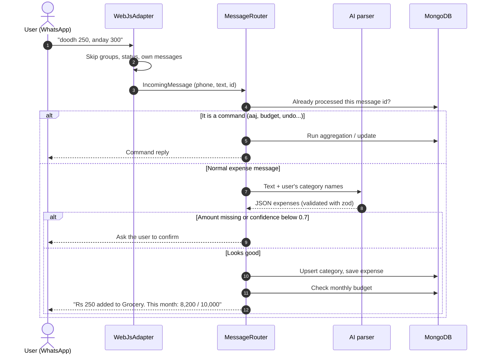
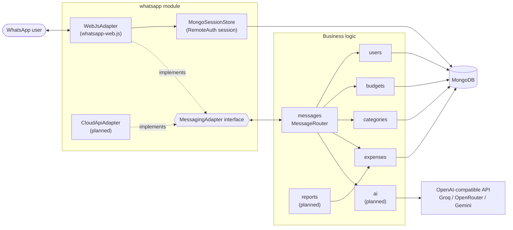
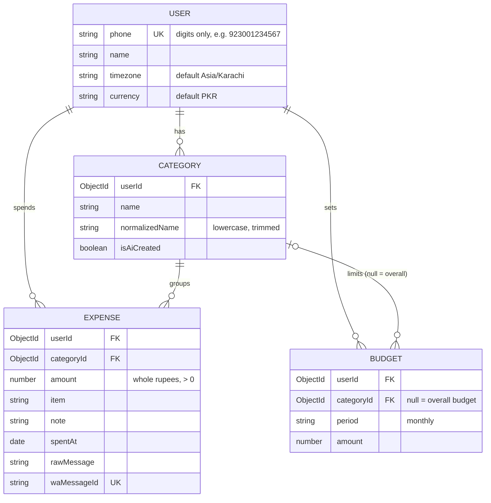
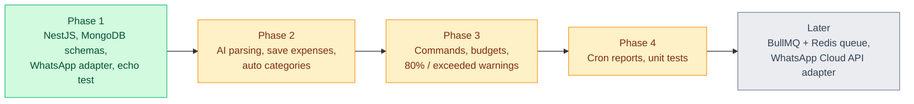

# whatsapp-expense-bot

AI-powered WhatsApp expense tracker for Roman Urdu/English messages, with budgets and reports. Built with NestJS, MongoDB and whatsapp-web.js.

Send a WhatsApp message like `doodh 250` or `petrol 3000 bike`. The bot saves the expense, picks a category (and creates a new one with AI when needed), keeps an eye on your budgets and sends daily, monthly and yearly reports.

> **Status:** Phase 1 of 4 is done. The NestJS app, MongoDB schemas and the WhatsApp connection work, and the bot currently runs an **echo test** (it replies `Echo: <your message>`). AI parsing, commands, budgets and reports are coming in the next phases. See [Roadmap](#roadmap).

---

## Contents

- [How it works](#how-it-works)
- [Architecture](#architecture)
- [Data model](#data-model)
- [Getting started](#getting-started)
- [Configuration](#configuration)
- [Scripts](#scripts)
- [Project structure](#project-structure)
- [Planned commands](#planned-commands)
- [Roadmap](#roadmap)
- [Troubleshooting](#troubleshooting)

---

## How it works

This is the target flow once all phases are done. Today only the WhatsApp receive and reply part is live.



Some details:

- **Idempotency:** every expense stores the WhatsApp message id (`<messageId>#<index>`) under a unique index, so the same message is never saved twice.
- **Timezones:** each user has a timezone (default `Asia/Karachi`). "Today" and "this month" are calculated in the user's timezone, not server UTC.
- **Amounts:** whole rupees only, always greater than 0.

## Architecture

Business logic never talks to whatsapp-web.js directly. Everything goes through the `MessagingAdapter` interface, so the official WhatsApp Cloud API can be added later by writing one new adapter.



**WhatsApp session:** the bot uses `RemoteAuth`, so the WhatsApp login is stored in MongoDB (GridFS) and survives restarts. You only scan the QR code once.

**Reconnects:** if WhatsApp disconnects or fails to start, the adapter logs it and reconnects with backoff (5s, 10s, 20s ... up to 5 minutes).

## Data model

All collections have `createdAt` and `updatedAt` (`timestamps: true`).



| Collection | Indexes |
|---|---|
| `users` | `phone` unique |
| `categories` | `{ userId, normalizedName }` unique |
| `expenses` | `waMessageId` unique, `{ userId, spentAt }`, `{ userId, categoryId, spentAt }` |
| `budgets` | `{ userId, categoryId, period }` unique |

New users will get these default categories: Grocery, Fuel, Bills, Food, Transport, Shopping, Health, Other.

## Getting started

### Requirements

- Node.js 24+
- [pnpm](https://pnpm.io) 11+ (the project only allows pnpm)
- Google Chrome installed (the bot uses your installed Chrome, it does not download one)
- MongoDB: a free [MongoDB Atlas](https://www.mongodb.com/atlas) cluster, or local MongoDB with Docker (see below)
- A WhatsApp account to link as the bot (a spare number is best)

### Setup

```bash
git clone https://github.com/waqarranadev/whatsapp-expense-bot.git
cd whatsapp-expense-bot
pnpm install
cp .env.example .env
```

Edit `.env`. At minimum set `MONGODB_URI`, `CHROME_PATH` and `WA_ALLOWED_NUMBERS` (see [Configuration](#configuration)).

Local MongoDB instead of Atlas (optional):

```bash
docker compose up -d
# then in .env:
# MONGODB_URI=mongodb://localhost:27017/expense_bot
```

### Run

```bash
pnpm dev
```

1. A QR code appears in the terminal. On your phone open **WhatsApp > Linked devices > Link a device** and scan it.
2. Wait for `WhatsApp client is ready`.
3. Wait about one more minute for `WhatsApp session saved to MongoDB`. After that, restarts will not ask for the QR again.
4. From **another phone**, send any message to the bot's number. You should get `Echo: <your message>` back.

> Messages you send from the bot's own number are ignored on purpose, so the "Message yourself" chat will not work for testing.

## Configuration

All settings come from `.env` and are validated with zod at startup. The app refuses to start if something is wrong and tells you which variable.

| Variable | Required | Default | Description |
|---|---|---|---|
| `NODE_ENV` | | `development` | `development` gives pretty logs |
| `LOG_LEVEL` | | `info` | `fatal` `error` `warn` `info` `debug` `trace` |
| `MONGODB_URI` | yes | | MongoDB connection string |
| `DNS_SERVERS` | | | e.g. `1.1.1.1,8.8.8.8`. Set it if you get `querySrv ECONNREFUSED` |
| `CHROME_PATH` | yes on Windows | | Path to `chrome.exe` |
| `WA_CLIENT_ID` | | `expense-bot` | Session name in MongoDB. Change it to link a different account |
| `WA_BACKUP_SYNC_MS` | | `300000` | How often the session is backed up (min `60000`) |
| `WA_ALLOWED_NUMBERS` | recommended | empty | Comma-separated numbers the bot answers. **Empty = everyone** |
| `DEFAULT_TIMEZONE` | | `Asia/Karachi` | Timezone for new users |
| `DEFAULT_CURRENCY` | | `PKR` | Currency for new users |
| `AI_BASE_URL` | phase 2 | | Any OpenAI-compatible endpoint |
| `AI_API_KEY` | phase 2 | | API key for that provider |
| `AI_MODEL` | phase 2 | | Model name |
| `AI_TIMEOUT_MS` | | `20000` | Timeout per AI call |
| `AI_MAX_RETRIES` | | `2` | Retries per AI call |

Free AI providers that work with the OpenAI-compatible client:

| Provider | `AI_BASE_URL` |
|---|---|
| Groq | `https://api.groq.com/openai/v1` |
| OpenRouter | `https://openrouter.ai/api/v1` |
| Google Gemini | `https://generativelanguage.googleapis.com/v1beta/openai/` |

## Scripts

| Command | What it does |
|---|---|
| `pnpm dev` | Run with auto-restart on file changes |
| `pnpm build` | Compile to `dist/` |
| `pnpm start` | Run the compiled app |
| `pnpm typecheck` | Type-check without building |
| `pnpm test` | Run unit tests (added in phase 4) |

> Every restart in `pnpm dev` also restarts Chrome and reconnects WhatsApp, which takes about 10 to 15 seconds.

## Project structure

```
src/
├── main.ts                      # Bootstrap (no HTTP server yet)
├── app.module.ts                # Wires config, logger, MongoDB and feature modules
├── config/                      # Env validation (zod) + typed AppConfigService
├── common/                      # Shared validators
├── whatsapp/
│   ├── messaging-adapter.interface.ts   # MessagingAdapter + IncomingMessage
│   ├── webjs.adapter.ts                 # whatsapp-web.js implementation
│   ├── mongo-session.store.ts           # RemoteAuth session in MongoDB (GridFS)
│   └── whatsapp.module.ts
├── messages/                    # MessageRouter: entry point for every message
├── users/                       # User schema
├── categories/                  # Category schema, name normalizing, defaults
├── expenses/                    # Expense schema
└── budgets/                     # Budget schema
```

## Planned commands

Commands are case-insensitive and Roman Urdu friendly. They arrive in phase 3.

| Message | Reply |
|---|---|
| `aaj` / `today` | Today's total by category |
| `is mahine` / `month` | Current month summary |
| `saal` / `year` | Yearly summary by month |
| `budget grocery 10000` | Set a monthly budget for a category |
| `budget 50000` | Set the overall monthly budget |
| `categories` | List your categories |
| `undo` | Delete your last expense |
| `help` | List all commands |

Anything that is not a command is treated as an expense. Several expenses in one message work too: `doodh 250, anday 300`.

## Roadmap



- [x] **Phase 1:** NestJS + TypeScript (strict), config validation, structured logging (pino), MongoDB schemas and indexes, WhatsApp adapter with RemoteAuth and auto-reconnect, echo test
- [ ] **Phase 2:** AI parser (strict JSON validated with zod, Roman Urdu amounts like `3k`, `1.5k`, `dhai sau`), auto-create users with default categories, category upsert, save expenses, replies
- [ ] **Phase 3:** commands, budgets with warnings at 80% and when exceeded, confirmation for unclear messages
- [ ] **Phase 4:** daily (10 PM), monthly (1st, 9 AM) and yearly (1 Jan) reports in each user's timezone, unit tests for the AI parser and command parser
- [ ] **Later:** BullMQ + Redis message queue, official WhatsApp Cloud API adapter

## Troubleshooting

**`querySrv ECONNREFUSED` when connecting to MongoDB Atlas**
On some Windows networks Node cannot read the system DNS server (an IPv6 router address), so `mongodb+srv://` lookups fail. Add this to `.env`:

```
DNS_SERVERS=1.1.1.1,8.8.8.8
```

**`The browser is already running for ...\.wwebjs_auth\RemoteAuth-expense-bot`**
An old Chrome from a previous run (usually after a crash) is still holding the session folder, or the bot is running twice. Stop all `pnpm dev` terminals, close the leftover Chrome from Task Manager, and start again.

**QR code appears on every restart**
The session is only saved to MongoDB about one minute after `WhatsApp client is ready`. Wait for `WhatsApp session saved to MongoDB` before stopping the bot.

**Bot does not reply**
- Check that the log shows `WhatsApp client is ready`. Messages are not delivered before that.
- If `WA_ALLOWED_NUMBERS` is set, the sender's number must be in it (digits only, with country code, e.g. `923001234567`).
- Set `LOG_LEVEL=debug` to see why a message was skipped (`own message`, `group/channel/broadcast`, `non-text`).

---

> **Note:** whatsapp-web.js is an unofficial client. WhatsApp may block numbers that use it, so a spare number is safer. The planned Cloud API adapter is the official route.
